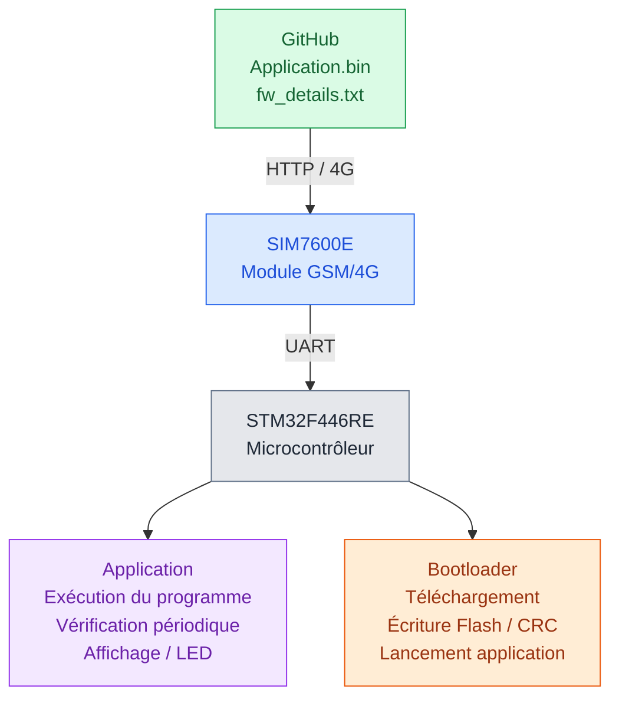
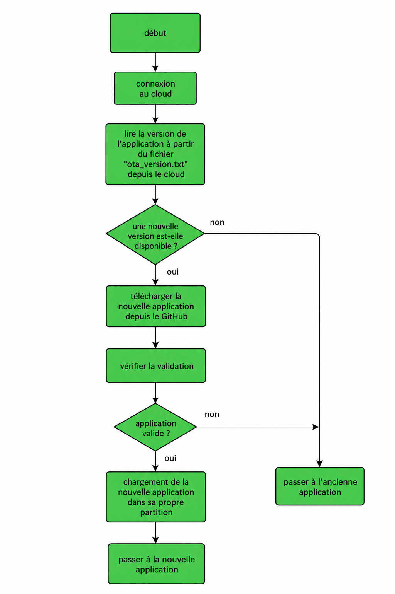

# Système de mise à jour OTA pour STM32 via GSM/4G

**Développement d'un système de mise à jour du firmware à distance pour objets connectés**

**Projet de fin d'études — Master Réseaux, Mobilité et Systèmes Embarqués**  
Université Mouloud Mammeri de Tizi-Ouzou — 2023/2024  
**Réalisé par :** Mahdi Djennad

## 1. Présentation du projet

Ce projet consiste à concevoir et développer un système de mise à jour du firmware à distance, appelé **OTA (Over-The-Air)**, pour un microcontrôleur STM32, en utilisant un module de communication GSM/4G SIM7600E.

L'objectif est de permettre à un objet connecté de recevoir et d'installer une nouvelle version de son programme embarqué sans nécessiter une intervention physique sur le microcontrôleur.

Le système repose sur une application embarquée, un bootloader, un module de communication GSM/4G et un dépôt GitHub utilisé pour héberger les fichiers de mise à jour.

L'application vérifie périodiquement la disponibilité d'une nouvelle version du firmware. Lorsqu'une mise à jour est détectée, le microcontrôleur redémarre et le bootloader prend en charge son téléchargement, sa vérification et son installation.

Le système utilise une organisation de la mémoire Flash en plusieurs zones, une vérification d'intégrité par CRC32 et des mécanismes de gestion des erreurs.

## 2. Objectifs du projet

- Développer un système de mise à jour OTA pour une carte STM32.
- Établir une communication GSM/4G avec le module SIM7600E.
- Télécharger un firmware distant à travers le protocole HTTP.
- Développer un bootloader pour gérer les mises à jour.
- Gérer deux emplacements de stockage du firmware en mémoire Flash.
- Vérifier l'intégrité du firmware téléchargé à l'aide du CRC32.
- Prévoir une gestion des erreurs et un mécanisme de récupération.
- Valider le fonctionnement du système sur du matériel réel.

## 3. Matériel et technologies utilisés

| Élément | Utilisation |
|---|---|
| STM32 Nucleo-F446RE | Carte de développement |
| SIM7600E | Module de communication GSM/4G |
| LED rouge, verte et bleue | Identification des versions de démonstration |
| Langage C | Programmation embarquée |
| STM32CubeIDE | Développement et compilation |
| STM32 HAL | Gestion des périphériques |
| UART | Communication série |
| Commandes AT | Configuration et pilotage du SIM7600E |
| HTTP | Récupération des fichiers de mise à jour |
| GitHub | Hébergement distant du firmware |
| CRC32 | Contrôle de l'intégrité des données |
| STM32CubeProgrammer | Programmation initiale du microcontrôleur |

## 4. Architecture générale du système



*Architecture fonctionnelle simplifiée du système OTA.*

Les fichiers nécessaires à la mise à jour sont hébergés sur GitHub. La STM32 y accède par l'intermédiaire du module SIM7600E, qui assure la communication à travers le réseau mobile.

Deux programmes interviennent dans le système : l'application, qui s'exécute normalement et recherche les mises à jour, et le bootloader, qui gère le téléchargement et l'installation du firmware.

## 5. Fonctionnement de l'application (`main.c`)

Le fichier `main.c` correspond à l'application exécutée sur le microcontrôleur STM32.

Dans le cadre de ce projet, plusieurs versions de démonstration ont été utilisées afin de vérifier le fonctionnement des mises à jour OTA.

Chaque version est identifiable par un message affiché sur le terminal série et par l'allumage d'une LED de couleur spécifique.

| Version | Indication visuelle |
|---|---|
| **Application 1** | 🔴 LED rouge |
| **Application 2** | 🟢 LED verte |
| **Application 3** | 🔵 LED bleue |

*Identification des trois versions de démonstration du firmware.*

L'application réalise les opérations suivantes :

1. Initialise les périphériques nécessaires, notamment GPIO, TIM3, USART3 et USART6.
2. Affiche le message correspondant à la version exécutée sur le terminal série.
3. Active la LED correspondant à la version de démonstration.
4. Vérifie périodiquement la disponibilité d'une mise à jour toutes les 30 secondes.
5. Compare les informations du firmware distant avec celles du firmware actuel.
6. Redémarre le microcontrôleur lorsqu'une mise à jour est détectée.

L'application assure donc le fonctionnement normal du système et la détection des mises à jour. Lorsqu'une nouvelle version est disponible, elle redémarre le système.


### Diagramme de fonctionnement de l'application


## 6. Fonctionnement du bootloader (`main(1).c`)

Le bootloader est responsable de la gestion du processus de mise à jour et du lancement de l'application.

Il assure notamment la communication avec le module GSM/4G, le téléchargement du firmware, l'écriture dans la mémoire Flash et la vérification de l'intégrité des données.

Son fonctionnement comprend les étapes suivantes :

1. Initialisation des périphériques et de la communication GSM/4G.
2. Consultation des informations du firmware hébergées sur GitHub.
3. Comparaison avec les informations du firmware enregistré.
4. Téléchargement du nouveau firmware lorsqu'une mise à jour est nécessaire.
5. Écriture des données dans la mémoire Flash.
6. Vérification de l'intégrité du firmware à l'aide du CRC32.
7. Mise à jour des informations de configuration.
8. Vérification de la validité de l'application.
9. Démarrage de l'application.

Le bootloader comporte également une gestion des erreurs, des tentatives supplémentaires en cas d'échec et une fonction de récupération `rollback()`.


### Diagramme de fonctionnement du bootloader



## 7. Organisation de la mémoire Flash

Le système utilise plusieurs zones de la mémoire Flash interne de la STM32 pour stocker les informations de configuration, les images firmware et l'application exécutable.

| Zone mémoire | Adresse de début | Rôle |
|---|---|---|
| Configuration | `0x0800C000` | Métadonnées des firmwares |
| Application | `0x08020000` | Zone d'exécution |
| Slot 0 | `0x08040000` | Stockage d'une image firmware |
| Slot 1 | `0x08060000` | Stockage d'une autre image firmware |

Les deux slots permettent de conserver des images de firmware distinctes.

La structure `ETX_FW_INFO_` contient les informations nécessaires à leur gestion : taille, CRC, slot actif et compteur de mises à jour OTA.

## 8. Préparation et hébergement du firmware

La préparation d'une mise à jour nécessite deux fichiers :

- `Application.bin` : le programme compilé à installer sur la STM32.
- `fw_details.txt` : les informations associées au firmware.

Le programme PC `etx_ota_update_main.c` lit le fichier binaire, calcule sa taille et son CRC, puis génère `fw_details.txt` sous la forme suivante :

```text
SIZ=0xXXXXXXXX
CRC=0xXXXXXXXX
```

Le code prévoit une taille maximale de firmware de **128 Kio** et un traitement par blocs de **1 024 octets**.

Une fois préparés, les fichiers sont placés sur GitHub, où ils peuvent être récupérés par la STM32 via le réseau GSM/4G.

## 9. Tests et validation du système

Pour valider le fonctionnement du système OTA, plusieurs versions de l'application ont été utilisées.

La première version affiche `Application 1` et allume la LED rouge.

Après l'installation d'une nouvelle version, le terminal affiche `Application 2` et la LED verte s'allume.

Une autre mise à jour permet de passer à `Application 3`, identifiable par la LED bleue.

Cette méthode permet de vérifier que le système est capable de récupérer un nouveau firmware, de l'installer et d'exécuter la nouvelle application.

Le projet comporte également une vérification CRC32 et une gestion des erreurs dans le bootloader.

## 10. Compétences techniques mobilisées

Ce projet a permis de mettre en œuvre des compétences en développement embarqué, notamment la programmation en C sur STM32, la conception d'un bootloader, la gestion de la mémoire Flash, la communication UART, l'utilisation des commandes AT et du module SIM7600E, le téléchargement HTTP de fichiers binaires, le contrôle CRC32 et la validation sur matériel réel.

## 11. Disponibilité du code source

Ce dépôt GitHub est destiné à présenter l'architecture, les choix techniques et les résultats du projet.

Le code source complet de l'application et du bootloader n'est pas publié dans ce dépôt public.

## 12. Auteurs et contact

**Mahdi Djennad**  
Master Réseaux, Mobilité et Systèmes Embarqués  
Université Mouloud Mammeri de Tizi-Ouzou — 2024

**Contact : Mahdi Djennad**

GitHub : [github.com/djennadmahdi](https://github.com/djennadmahdi)
