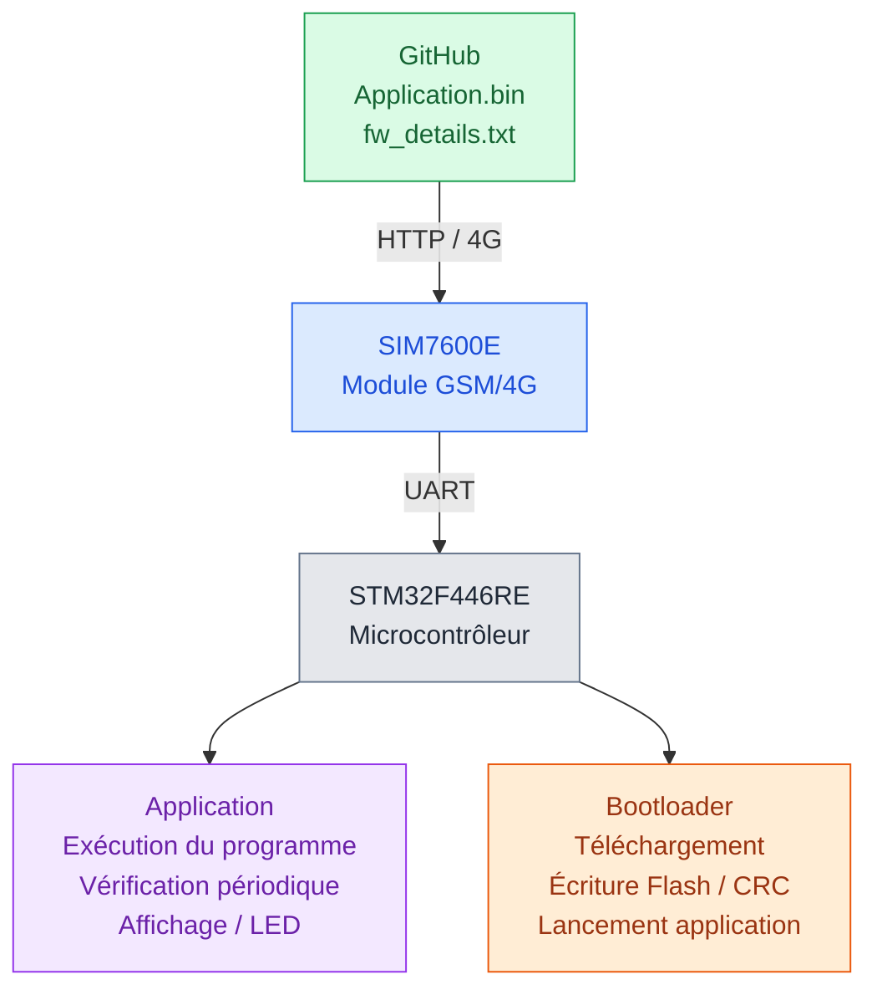
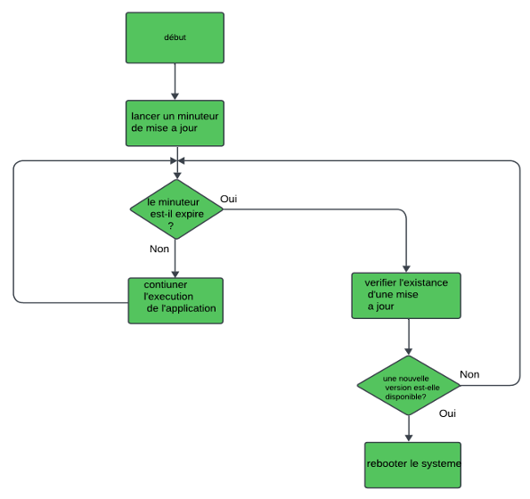
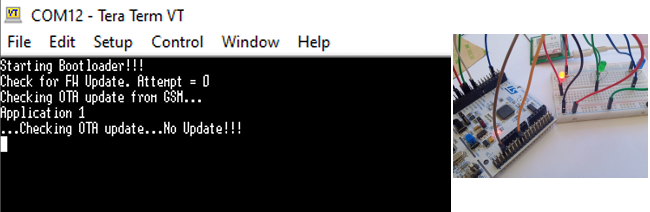
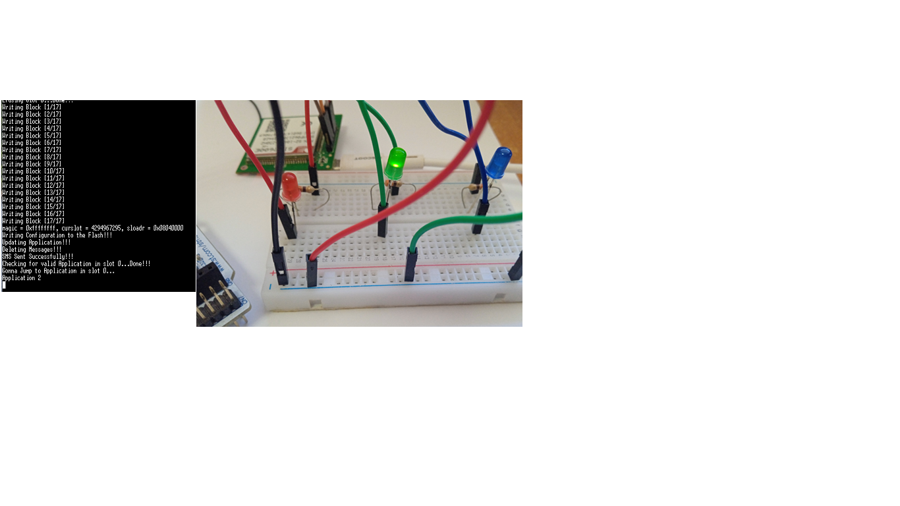

# Système de mise à jour OTA pour STM32 via GSM/4G

**Développement d'un système de mise à jour du firmware à distance pour objets connectés**

**Projet de fin d'études — Master Réseaux, Mobilité et Systèmes Embarqués**  
Université Mouloud Mammeri de Tizi-Ouzou — 2023/2024  
**Réalisé par :** Mahdi Djennad

## 1. Présentation du projet

Ce projet consiste à concevoir et développer un système de mise à jour du firmware à distance, appelé **OTA (Over-The-Air)**, pour un microcontrôleur STM32, en utilisant un module de communication GSM/4G SIM7600E.

L'objectif est de permettre à un objet connecté de recevoir et d'installer une nouvelle version de son programme embarqué sans nécessiter une intervention physique sur le microcontrôleur.

Le système repose sur une application embarquée, un bootloader, un module de communication GSM/4G et un dépôt GitHub utilisé pour héberger les fichiers de mise à jour.

L'application vérifie périodiquement la disponibilité d'une nouvelle version du firmware. Lorsqu'une mise à jour est détectée, le microcontrôleur redémarre et le bootloader prend en charge son téléchargement, sa vérification et son installation.

Le système utilise une organisation de la mémoire Flash en plusieurs zones, une vérification d'intégrité par CRC32 et des mécanismes de gestion des erreurs.

## 2. Objectifs du projet

- Développer un système de mise à jour OTA pour une carte STM32.
- Établir une communication GSM/4G avec le module SIM7600E.
- Télécharger un firmware distant à travers le protocole HTTP.
- Développer un bootloader pour gérer les mises à jour.
- Gérer deux emplacements de stockage du firmware en mémoire Flash.
- Vérifier l'intégrité du firmware téléchargé à l'aide du CRC32.
- Prévoir une gestion des erreurs et un mécanisme de récupération.
- Valider le fonctionnement du système sur du matériel réel.

## 3. Matériel et technologies utilisés

| Élément | Utilisation |
|---|---|
| STM32 Nucleo-F446RE | Carte de développement |
| SIM7600E | Module de communication GSM/4G |
| LED rouge, verte et bleue | Identification des versions de démonstration |
| Langage C | Programmation embarquée |
| STM32CubeIDE | Développement et compilation |
| STM32 HAL | Gestion des périphériques |
| UART | Communication série |
| Commandes AT | Configuration et pilotage du SIM7600E |
| HTTP | Récupération des fichiers de mise à jour |
| GitHub | Hébergement distant du firmware |
| CRC32 | Contrôle de l'intégrité des données |
| STM32CubeProgrammer | Programmation initiale du microcontrôleur |

## 4. Architecture générale du système



*Architecture fonctionnelle simplifiée du système OTA.*

Les fichiers nécessaires à la mise à jour sont hébergés sur GitHub. La STM32 y accède par l'intermédiaire du module SIM7600E, qui assure la communication à travers le réseau mobile.

Deux programmes interviennent dans le système : l'application, qui s'exécute normalement et recherche les mises à jour, et le bootloader, qui gère le téléchargement et l'installation du firmware.

## 5. Fonctionnement de l'application (`main.c`)

Le fichier `main.c` correspond à l'application exécutée sur le microcontrôleur STM32.

Dans le cadre de ce projet, plusieurs versions de démonstration ont été utilisées afin de vérifier le fonctionnement des mises à jour OTA.

Chaque version est identifiable par un message affiché sur le terminal série et par l'allumage d'une LED de couleur spécifique.

### Identification des trois versions de démonstration


L'application réalise les opérations suivantes :

1. Initialise les périphériques nécessaires, notamment GPIO, TIM3, USART3 et USART6.
2. Affiche le message correspondant à la version exécutée sur le terminal série.
3. Active la LED correspondant à la version de démonstration.
4. Vérifie périodiquement la disponibilité d'une mise à jour toutes les 30 secondes.
5. Compare les informations du firmware distant avec celles du firmware actuel.
6. Redémarre le microcontrôleur lorsqu'une mise à jour est détectée.

L'application assure donc le fonctionnement normal du système et la détection des mises à jour. Lorsqu'une nouvelle version est disponible, elle redémarre le système.


### Diagramme de fonctionnement de l'application




## 6. Fonctionnement du bootloader (`main(1).c`)

Le bootloader est responsable de la gestion du processus de mise à jour et du lancement de l'application.

Il assure notamment la communication avec le module GSM/4G, le téléchargement du firmware, l'écriture dans la mémoire Flash et la vérification de l'intégrité des données.

Son fonctionnement comprend les étapes suivantes :

1. Initialisation des périphériques et de la communication GSM/4G.
2. Consultation des informations du firmware hébergées sur GitHub.
3. Comparaison avec les informations du firmware enregistré.
4. Téléchargement du nouveau firmware lorsqu'une mise à jour est nécessaire.
5. Écriture des données dans la mémoire Flash.
6. Vérification de l'intégrité du firmware à l'aide du CRC32.
7. Mise à jour des informations de configuration.
8. Vérification de la validité de l'application.
9. Démarrage de l'application.

Le bootloader comporte également une gestion des erreurs, des tentatives supplémentaires en cas d'échec et une fonction de récupération `rollback()`.


### Diagramme de fonctionnement du bootloader


## 7. Organisation de la mémoire Flash

Le système utilise plusieurs zones de la mémoire Flash interne de la STM32 pour stocker les informations de configuration, les images firmware et l'application exécutable.

| Zone mémoire | Adresse de début | Rôle |
|---|---|---|
| Configuration | `0x0800C000` | Métadonnées des firmwares |
| Application | `0x08020000` | Zone d'exécution |
| Slot 0 | `0x08040000` | Stockage d'une image firmware |
| Slot 1 | `0x08060000` | Stockage d'une autre image firmware |

Les deux slots permettent de conserver des images de firmware distinctes.

La structure `ETX_FW_INFO_` contient les informations nécessaires à leur gestion : taille, CRC, slot actif et compteur de mises à jour OTA.

## 8. Préparation et hébergement du firmware

La préparation d'une mise à jour nécessite deux fichiers :

- `Application.bin` : le programme compilé à installer sur la STM32.
- `fw_details.txt` : les informations associées au firmware.

Le programme PC `etx_ota_update_main.c` lit le fichier binaire, calcule sa taille et son CRC, puis génère `fw_details.txt` sous la forme suivante :

```text
SIZ=0xXXXXXXXX
CRC=0xXXXXXXXX
```

Le code prévoit une taille maximale de firmware de **128 Kio** et un traitement par blocs de **1 024 octets**.

Une fois préparés, les fichiers sont placés sur GitHub, où ils peuvent être récupérés par la STM32 via le réseau GSM/4G.

## 9. Tests et validation du système

Le système de mise à jour OTA a été testé sur une carte **STM32 Nucleo-F446RE**, associée au module de communication **SIM7600E**.

Les essais ont permis de vérifier le démarrage du firmware initial, le téléchargement d'une nouvelle version et le comportement du système en cas d'interruption du processus de mise à jour.

### Test 1 — Exécution de l'application initiale

Le premier test consiste à vérifier le bon fonctionnement de l'application 1 après son installation sur le microcontrôleur.

Au démarrage, une **LED rouge** s'allume pour identifier la version initiale du firmware.

L'application effectue également une vérification périodique de la disponibilité des mises à jour, toutes les **30 secondes**. Les informations d'exécution peuvent être observées à l'aide du terminal série Tera Term.



*Figure 1 — Exécution de l'application initiale et affichage des messages sur Tera Term.*

### Test 2 — Mise à jour OTA vers l'application 2

Le deuxième test consiste à télécharger et installer une nouvelle version du firmware à distance, à travers le module GSM/4G.

Le système récupère le fichier binaire de la nouvelle version et effectue une vérification de son intégrité à l'aide du **CRC32**.

Après l'installation et le redémarrage, l'application 2 s'exécute. La **LED passe du rouge au vert**, ce qui permet de visualiser le changement de version directement sur la carte STM32.

Ce test démontre le fonctionnement du mécanisme de mise à jour OTA sur le prototype matériel.



Figure 2 — Mise à jour OTA vers l’application 2 : journal d’exécution du processus et validation matérielle par l’allumage de la LED verte.

### Test 3 — Gestion des interruptions et retour à la version précédente

Un troisième scénario porte sur les interruptions pouvant survenir pendant une mise à jour, notamment une coupure de connexion, une interruption d'alimentation ou un firmware corrompu.

L'architecture du système repose sur deux emplacements de stockage du firmware (*slots*) afin de conserver une version précédente et de permettre un retour à celle-ci en cas d'échec.

Ce mécanisme vise à préserver le fonctionnement du dispositif lorsqu'une mise à jour ne peut pas être terminée correctement.


*Figure 3 — Interruption du transfert OTA et retour à l'application 2 précédemment installée.*

### Résultats observés

Les essais présentés dans le mémoire mettent en évidence :

- Le démarrage de l'application initiale, signalé par une LED rouge.
- La vérification périodique des mises à jour toutes les 30 secondes.
- Le téléchargement et l'installation d'une nouvelle version du firmware.
- Le passage à l'application 2, confirmé par l'allumage d'une LED verte.
- La prise en compte des scénarios d'interruption dans le mécanisme de mise à jour.

### Résultat chiffré

Lors des essais de mise à jour OTA, un firmware d'une taille
de **17 480 octets (environ 17,1 Kio)** a été utilisé.

Le journal d'exécution permet de suivre le téléchargement,
l'écriture du firmware dans la mémoire Flash et le démarrage
de l'application après la mise à jour.

## 10. Compétences techniques mobilisées

Ce projet a permis de mettre en œuvre des compétences en développement embarqué, notamment la programmation en C sur STM32, la conception d'un bootloader, la gestion de la mémoire Flash, la communication UART, l'utilisation des commandes AT et du module SIM7600E, le téléchargement HTTP de fichiers binaires, le contrôle CRC32 et la validation sur matériel réel.

## 11. Disponibilité du code source

Ce dépôt GitHub présente l'architecture, le fonctionnement et les principaux résultats du système de mise à jour OTA développé pour le microcontrôleur STM32F446RE.

Une partie du code source est mise à disposition afin d'illustrer les différentes étapes du processus de mise à jour.

### Application embarquée STM32

L'application développée en C embarqué assure la vérification périodique des mises à jour OTA, toutes les 30 secondes, à l'aide du module GSM/4G SIM7600E.

Elle récupère les informations du firmware distant via HTTP, compare sa taille et son CRC32 avec ceux du firmware actuel et déclenche un redémarrage du microcontrôleur lorsqu'une mise à jour est détectée.

📁 [Consulter le code source de l'application STM32](application/)

### Outil de calcul de la taille et du CRC32

Un utilitaire développé en C permet d'analyser le fichier binaire `Application.bin`, de calculer sa taille et son CRC32, puis de générer automatiquement le fichier `fw_details.txt`.

Ce fichier contient les métadonnées nécessaires à la détection et à la vérification des mises à jour OTA.

📁 [Consulter le code source et les instructions d'utilisation](firmware-tools/)

### Code du bootloader

Le bootloader assure le téléchargement, la vérification et l'installation du nouveau firmware dans la mémoire Flash du STM32.

Son code source n'est pas publié dans ce dépôt public. Son architecture et son fonctionnement sont toutefois présentés dans la documentation du projet.

## 12. Auteurs et contact

**Mahdi Djennad**  
Projet de fin d'études -- Master Réseaux, Mobilité et Systèmes Embarqués  
Université Mouloud Mammeri de Tizi-Ouzou — 2024

**Contact : Mahdi Djennad**

GitHub : [github.com/djennadmahdi](https://github.com/djennadmahdi)

LinkedIn : [Profil LinkedIn](https://www.linkedin.com/in/mahdi-djennad)

Actuellement étudiant en Master 2 MIASHS — Informatique et Cognition à l'Université Grenoble Alpes, à la recherche d'un stage de fin d'études de six mois à partir de février 2027.
